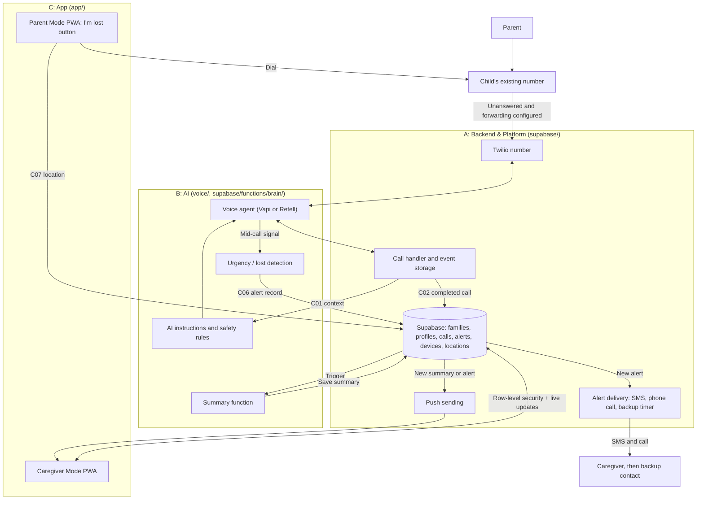

# Architecture

Status: agreed logical architecture (2026-10-13), not a deployed system.

## Components and ownership

## Boundaries

- Provider webhooks (Twilio, voice platform) terminate in A's call handler. B configures the voice agent and supplies instructions and detection; A does not edit B's prompts and B does not edit A's handlers.
- The app reads and writes Supabase directly, protected by row-level security, and subscribes to live updates (D07). There is no separate custom caregiver API.
- B's detection only **creates an alert record**. A's delivery code sends SMS/calls and records each attempt. Detection never waits for delivery, and delivery never waits for a transcript or summary.
- Storing a completed call does not run a summary by itself. A configures an explicit database trigger/webhook that calls B's summary function (D08).
- Parent Mode writes location records only from a paired device and only during an active "I'm lost" session.

## Identity and access

Resolve the family from the called Neul number or trusted provider routing metadata. A caller number alone does not establish identity. Unknown/withheld/shared-phone cases follow the agreed policy (D13) before personal context is disclosed. Verify provider webhooks with the provider's authentication mechanism.

Caregivers authenticate with Supabase Auth. Row-level security checks family membership on every read/write; never trust a client-provided family ID. Parent Mode devices have no login: a 6-digit pairing code (10-minute expiry) links one device to one family, and that device can only write its own location records. Service credentials stay server-side.

## Processing and reliability

- Urgent SMS/call attempts start during the call; they never wait for summary generation or push.
- Deduplicate provider events and jobs using stable IDs. Retries must not produce duplicate summaries, alerts or notifications.
- Store delivery attempts separately from caregiver acknowledgment. Provider acceptance is not human acknowledgment.
- Keep notification failures separate from saved-summary state. The app can still read a summary if push fails.
- Browser location only works while Parent Mode is open and in front. If no location arrives, Lost Mode still works through voice landmarks and the family's location-app link.
- Do not assume forwarding back to the child reaches voicemail; it may loop. Test a non-looping failure route before demonstrating it.
