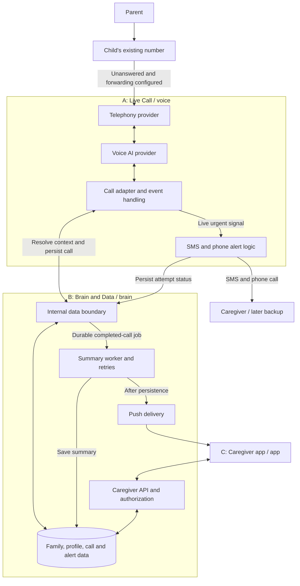

# Architecture

Status: proposed logical architecture, not a deployed system.

## Components and ownership

## Proposed boundary

Provider-specific webhooks terminate in A's code. A calls B-owned data operations for context, call storage, and alert records. C uses B's authenticated caregiver API. This scaffold chooses explicit service boundaries for clarity; whether internal operations become function calls, HTTP endpoints, or managed functions is pending stack selection.

The discussion document suggested direct database hand-offs. That can still be implemented internally, but database writes need an explicitly implemented trigger/job mechanism. Saving a row alone does not execute a summary worker. Do not build both a custom caregiver API and direct client DB access without deciding which is authoritative.

## Identity and access

Resolve the family from the called Neul number or trusted provider routing metadata. A caller number alone does not establish identity or permission. A family destination does not prove which parent is speaking. Unknown/withheld/shared-phone cases must follow the agreed policy before personal context is disclosed. Use the provider's authenticated webhook mechanism once selected.

C authenticates as a caregiver. The server checks family membership for every read/write, rather than trusting a client-provided family ID. Internal operations are not public caregiver endpoints.

## Processing and reliability

- A sends urgent SMS/call attempts during the call; this never waits for summary generation or app push.
- B durably registers summary work with the completed call, using a transaction/outbox or equivalent reliable mechanism to be chosen.
- Deduplicate provider events and jobs using stable IDs. Retry failures without producing duplicate summaries or notifications.
- Store delivery attempts separately from caregiver acknowledgment. Provider acceptance is not human acknowledgment.
- Keep notification failures separate from saved-summary state. The app can still read a summary if push fails.
- Do not assume forwarding back to the child reaches voicemail; it may loop. Test a non-looping failure route before demonstrating it.

No vendor, hosting environment, or database is selected by this diagram.
